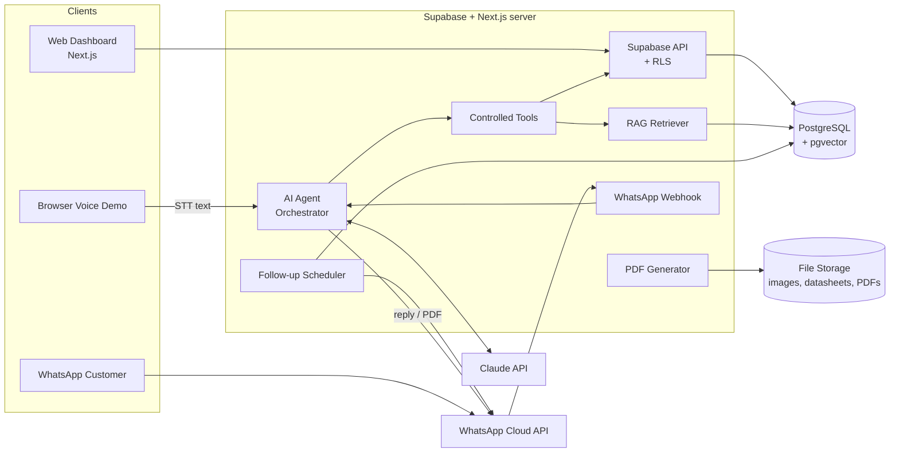

# AI Sales Assistant — Requirements Document

## 1. Project overview

AI Sales Assistant aik solar aur electrical wholesale/retail business ke liye sales platform hai. Is ka AI agent customers ki inquiries handle karta hai: product search, price, stock, technical sawalat aur quotations. Yeh kaam web dashboard, browser voice aur WhatsApp ke zariye hota hai, aur staff ke liye inventory, CRM aur follow-up tools bhi milte hain.

| Item | Detail |
|---|---|
| Business type | Solar aur electrical wholesale/retail |
| Products | Inverters, VFDs, batteries, cables, electrical accessories |
| Channels | Web dashboard, browser voice demo, WhatsApp Business Cloud API |
| Languages | Urdu, English, Punjabi |

## 2. Users and roles

| Role | Permissions |
|---|---|
| **Admin** | Sab kuch: users/roles, products, purchase cost, profit reports, settings, audit logs |
| **Manager** | Products, inventory, quotations approve karna, discounts approve karna, reports (profit included) |
| **Salesperson** | Customers, quotations draft karna, follow-ups, WhatsApp inbox, handoff conversations. Purchase cost aur profit **nahi** dekh sakta |
| **AI Agent** | Sirf controlled backend tools. Database ka direct access nahi, purchase cost nahi, approval ka ikhtiyar nahi |

## 3. Functional requirements

### 3.1 Products and inventory
- FR-01: Product add/edit/deactivate (SKU, brand, model, category, specs, image, datasheet).
- FR-02: Category management (nested categories allowed).
- FR-03: Purchase price, selling price aur minimum authorized price.
- FR-04: Stock IN/OUT/ADJUST sirf `stock_movements` ke zariye. Current stock = movements ka sum. Overwrite nahi hota.
- FR-05: Har product ka reorder level aur low-stock alert.
- FR-06: Product ki stock history.
- FR-07: Product search (name, SKU, brand, rating, category).

### 3.2 Customers and quotations
- FR-08: Customer CRM (name, phone, WhatsApp, city, type: retail/dealer/installer, notes, opt-out flag).
- FR-09: Quotation workflow: customer → items → backend se current prices → totals → discount validation → zaroorat par manager approval → PDF → save.
- FR-10: Minimum authorized price se neeche ki line approval ke baghair finalize nahi hogi.
- FR-11: Quotation statuses: `draft → pending_approval → approved → sent → accepted / rejected / expired`.
- FR-12: PDF business ke bill-book format mein.

### 3.3 AI sales agent
- FR-13: Agent sirf in tools ke zariye kaam karega: `search_product`, `get_current_price`, `check_stock`, `get_technical_info`, `calculate_quote`, `create_quotation`, `request_approval`, `schedule_followup`, `transfer_to_human`.
- FR-14: Agent prices invent nahi karega, purchase cost expose nahi karega, aur discounts approve nahi karega.
- FR-15: Information missing ho to agent clarifying sawal poochega (model, rating, load type, supply voltage).
- FR-16: Uncertain ya safety-critical technical sawal human technician ko handoff honge.

### 3.4 Technical knowledge base (RAG)
- FR-17: Manuals, datasheets aur FAQs upload (PDF/text), chunking aur embeddings.
- FR-18: Sirf approved documents se retrieval. Jawab ke saath source ka reference.

### 3.5 Voice agent
- FR-19: Browser mic → STT → agent → tools → TTS → speaker.
- FR-20: Urdu, English aur Punjabi ke test scenarios.

### 3.6 WhatsApp
- FR-21: Webhook incoming messages receive karega (signature verification aur idempotency ke saath).
- FR-22: Agent ka jawab, quotation PDF bhejna, conversation history save karna.
- FR-23: Conversation ko salesperson ko assign karna.
- FR-24: 24-hour customer-service window aur template message policy follow karna.

### 3.7 Follow-ups
- FR-25: Quotation send hone ke 3–4 din baad follow-up due.
- FR-26: Reject/accept/opt-out par follow-up auto-cancel.
- FR-27: Scheduler ka state database mein, taake server restart par tasks lost na hon.

### 3.8 Reports and audit
- FR-28: Sales, quotations conversion, top products, low-stock, AI conversation stats.
- FR-29: Profit reports sirf Admin/Manager ke liye.
- FR-30: Har sensitive action (price change, approval, stock adjust, login) audit log mein.

## 4. Non-functional requirements
- **Security:** Supabase Auth, role-based access database (RLS) par enforce hoga (sirf UI par nahi), passwords hashed, secrets `.env` mein.
- **Reliability:** Webhook idempotency (message ID unique), AI/API errors logged.
- **Performance:** Dashboard pages < 2s, agent ka response < 5s (text).
- **Data integrity:** Stock aur quotation operations DB transactions mein.

## 5. Tech stack

| Layer | Technology |
|---|---|
| Frontend | Next.js (App Router), TypeScript, Tailwind CSS |
| Backend | Supabase: PostgreSQL functions (business rules), Row Level Security, Next.js server actions |
| Database | PostgreSQL on Supabase (+ pgvector for RAG) |
| Auth / files | Supabase Auth, Supabase Storage |
| Hosting | Vercel (frontend), Supabase (database) |
| AI | Claude API (tool use) |
| Voice | Browser Web Speech API / cloud STT-TTS |
| Messaging | WhatsApp Business Cloud API |
| PDF | WeasyPrint / ReportLab |
| Scheduler | DB-backed jobs (APScheduler + `followups` table) |

## 6. System architecture

## 7. Database tables

`users, roles, products, categories, stock_movements, customers, calls, conversations, quotations, quotation_items, sales, sale_items, followups, knowledge_documents, approval_requests, audit_logs`

## 8. Final demo scenario
1. Admin product add karta hai.
2. Admin stock quantity set karta hai.
3. Customer AI agent se inquiry karta hai.
4. AI live price aur stock check karta hai.
5. AI relevant technical sawal poochta hai.
6. Quotation generate hoti hai.
7. Customer ko WhatsApp par PDF bheji jati hai.
8. Follow-up schedule hota hai.
9. Admin dashboard par poora interaction dekhta hai.
